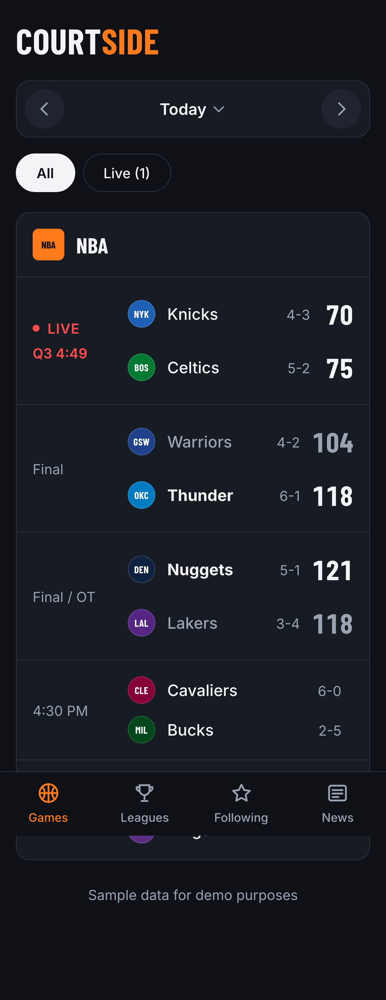
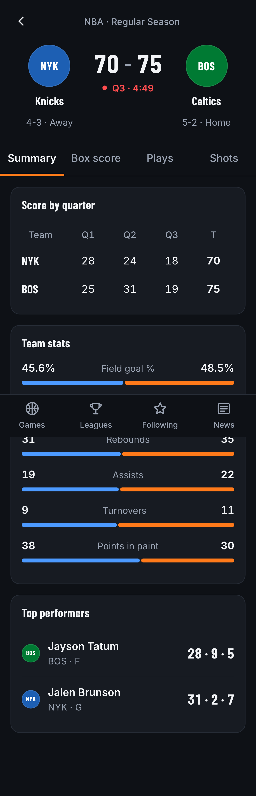
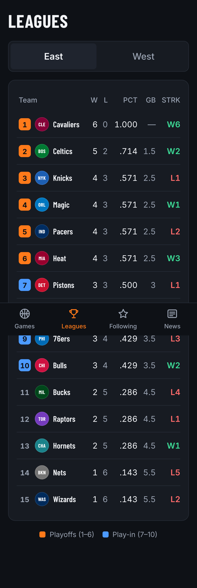
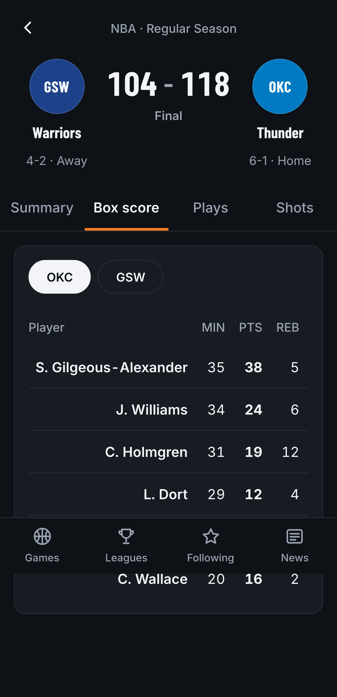
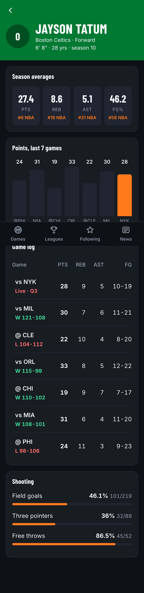
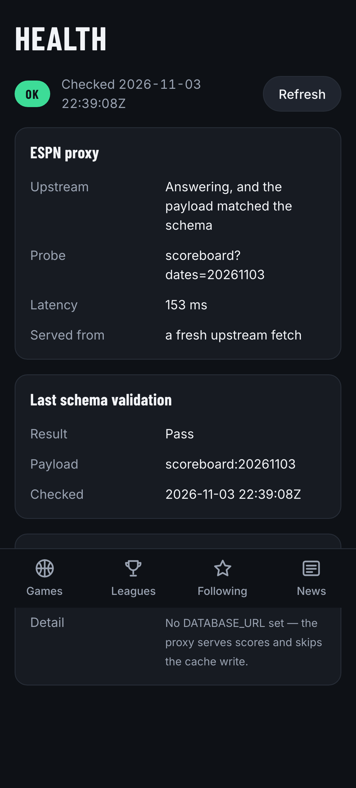

# Courtside

A FotMob-style NBA scores app — live scores, game detail, standings, and player stats.

Built as a portfolio project to demonstrate SDET practice end to end: a risk-based test
strategy, automation at every level from unit to contract, and CI that gates every pull
request.

**Live:** _pending first deploy_

| Games feed                                     | Game detail                                        | Standings                                    |
| ---------------------------------------------- | -------------------------------------------------- | -------------------------------------------- |
|  |  |  |

| Box score                                        | Player                                 | Health                                 |
| ------------------------------------------------ | -------------------------------------- | -------------------------------------- |
|  |  |  |

## Why this exists

The interesting problem here isn't rendering a scoreboard — it's that the data comes from a
third-party API nobody controls, changes shape without warning, and is only correct for a
few seconds at a time. That makes it a good place to show how you test something:

- **Schema drift** is caught by contract tests that run on a schedule, so an upstream change
  surfaces in a test report instead of on the screen.
- **Live data** is testable because the mock provider's live game runs on an injected clock —
  tests jump to halftime or final instantly instead of waiting.
- **Data correctness** is asserted structurally: a final score has to equal the sum of its
  quarters, and games-behind has to follow from wins and losses.
- **Production state** is answerable: `/health` reports whether ESPN is answering, whether
  the last payload matched the schema, and how stale the cache is.

See [`docs/TEST_PLAN.md`](docs/TEST_PLAN.md) for the risk assessment and traceability
matrix, [`docs/PLAN.md`](docs/PLAN.md) for milestones and acceptance criteria, and
[`docs/NOTES.md`](docs/NOTES.md) for the per-milestone log of what the tests caught.

## Architecture

```
Browser ──► DataProvider ──┬── MockProvider  (default, no network)
                           └── EspnProvider ──► /api/* ──► ESPN
                                                 │  memory cache 12s
                                                 │  Zod validation
                                                 └─► Postgres  (optional,
                                                      write-through)

/api/health ──► probes the proxy, reads the validation log and max(fetched_at)
contract/   ──► committed schema snapshots, re-checked against live ESPN daily
db/validations/ ──► SQL that selects violations; zero rows is the assertion
```

Components only ever see domain types from `src/data/types.ts`. No provider's wire format
leaks past `src/data/`, so swapping mock for live data changes no UI code. The browser never
calls ESPN directly — requests go through a Vercel serverless function that caches, validates
with Zod, and logs the exact field path when validation fails.

The provider is chosen by `VITE_DATA_PROVIDER` and defaults to mock, so a fresh clone runs
with no network and no configuration. The Postgres cache is optional in the same way: with no
`DATABASE_URL` the proxy skips the write and serves scores exactly as it would otherwise.

## Getting started

```bash
npm install
npm run dev
```

Runs against mock data, with no network calls.

For live data, set `VITE_DATA_PROVIDER=espn` and run the same command — the dev server
serves the `api/` proxy routes itself, so `vercel dev` is not needed:

```bash
VITE_DATA_PROVIDER=espn npm run dev
```

To re-capture ESPN responses as test fixtures:

```bash
npm run capture:espn              # today
npm run capture:espn -- 20261104  # a specific date
```

### Simulated live game

The mock data includes one game that advances in real time. To jump to a specific point
without waiting, pass an offset in milliseconds:

```
http://localhost:5173/?simOffset=3600000    # one hour in — game is over
```

### Health

`/health` renders `/api/health`: upstream status and latency, the last Zod validation result
with the field paths that broke, and the row count and age of each cached table. It needs no
database — an unconfigured cache reports as "Not configured" rather than as a failure.

### Optional Postgres cache

```bash
export DATABASE_URL=postgres://...   # Neon or Supabase
npm run db:migrate
```

## Tests

```bash
npm run typecheck     # tsc --noEmit
npm run lint          # eslint
npm run test:unit     # vitest — unit, component, proxy, cache, snapshots
npm run test:e2e      # playwright — desktop and 390×844 mobile
npm run test:smoke    # the fast gate
npm run test:visual   # snapshot comparison (macOS baselines)
npm run test:contract # live ESPN — scheduled, not on PRs
npm run lighthouse    # mobile budgets, median of three runs
```

| Level     | Tool               | What it covers                                             | Runs     |
| --------- | ------------------ | ---------------------------------------------------------- | -------- |
| Unit      | Vitest             | Normalization, status derivation, sim clock, date handling | Every PR |
| Component | Vitest + RTL       | Per-state rendering and accessible output                  | Every PR |
| E2E       | Playwright         | User journeys, desktop + mobile, live → final              | Every PR |
| Visual    | Playwright         | Layout and theme snapshots                                 | Local    |
| A11y      | axe-core           | Serious and critical violations per screen                 | Every PR |
| Data      | SQL against PGlite | Score vs. quarter sum, GB vs. W/L, in real Postgres        | Every PR |
| Perf      | Lighthouse         | Mobile performance, a11y and best-practices budgets        | Every PR |
| Contract  | Vitest, live ESPN  | Real responses against committed schema snapshots          | Daily    |

Component tests inject a stub `DataProvider` through context rather than mocking modules, so
they exercise the same code path production runs.

## Metrics

Measured on the M7 branch, 2026-11-03 — not estimated. See `docs/NOTES.md` for the history.

| Metric                      | Value                                                                                          |
| --------------------------- | ---------------------------------------------------------------------------------------------- |
| Tests                       | 358 unit/component/proxy/data · 98 e2e · 18 visual · 18 contract                               |
| Coverage                    | 87.5% statements, 75.5% branches                                                               |
| Local run time              | unit 9.5s · e2e 30s · smoke 13s · visual 15s                                                   |
| Lighthouse (mobile, median) | feed 96 · game detail 98 · standings 100                                                       |
| Accessibility               | 100 Lighthouse; zero serious or critical axe violations                                        |
| Bundle                      | 150 KiB JS gzipped, 5 KiB CSS                                                                  |
| Bugs caught by tests        | Logged per milestone in `docs/NOTES.md` — five from the M4 backfill, four of them user-visible |

## CI/CD

Every pull request runs typecheck, lint, format check, unit tests with coverage, the full
Playwright suite on both viewports, and the Lighthouse budgets. The HTML report, traces and
coverage upload as artifacts on every run. Flaky tests — failed then passed on retry — are
reported separately from passes in the step summary.

The live contract suite runs on its own daily schedule rather than on PRs, so ESPN changing
shape fails a contract run instead of an unrelated pull request.

Deploys are handled by Vercel's Git integration: production on merge to `main`, a preview URL
for every pull request.

### One-time setup for a fork

1. Import the repo at [vercel.com/new](https://vercel.com/new) — the framework preset and
   build command are detected automatically.
2. In GitHub, enable branch protection on `main` and require the `quality` and `e2e` checks.
3. Optionally set `DATABASE_URL` in Vercel and run `npm run db:migrate` to turn on the cache.

## Stack

Vite · React · TypeScript (strict) · React Router · TanStack Query · Zod · plain CSS with
design tokens · Vitest · React Testing Library · Playwright · PGlite · Lighthouse ·
GitHub Actions · Vercel

## Disclaimer

Data comes from ESPN's unofficial, undocumented endpoints. This project is not affiliated
with, authorized by, or endorsed by the NBA, ESPN, or any of their affiliates. It is a
non-commercial portfolio project. All team names and logos are the property of their
respective owners.
