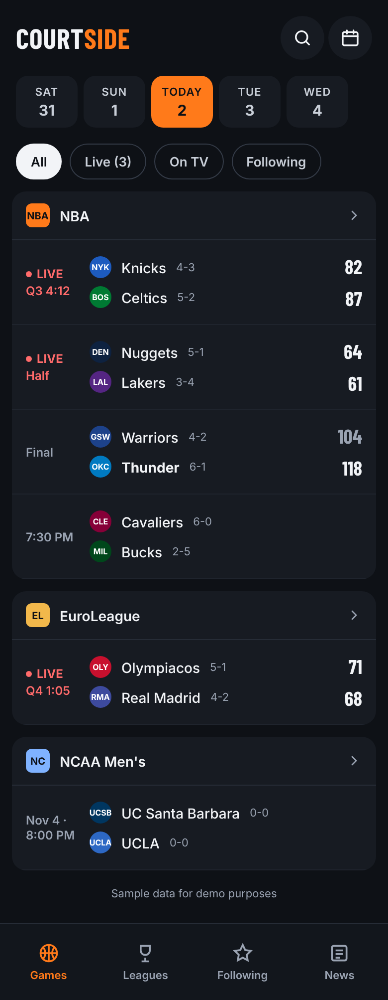

# Courtside

A FotMob-style NBA scores app — live scores, game detail, standings, and player stats.

Built as a portfolio project to demonstrate SDET practice end to end: a risk-based test
strategy, automation at every level from unit to contract, and CI that gates every pull
request.

**Live:** _pending first deploy_



## Why this exists

The interesting problem here isn't rendering a scoreboard — it's that the data comes from a
third-party API nobody controls, changes shape without warning, and is only correct for a
few seconds at a time. That makes it a good place to show how you test something:

- **Schema drift** is caught by contract tests that run on a schedule, so an upstream change
  surfaces in a test report instead of on the screen.
- **Live data** is testable because the mock provider's live game runs on an injected clock —
  tests jump to halftime or final instantly instead of waiting.
- **Data correctness** is asserted structurally: a final score has to equal the sum of its
  quarters, and games-behind has to follow from wins and losses.

See [`docs/TEST_PLAN.md`](docs/TEST_PLAN.md) for the risk assessment and traceability
matrix, and [`docs/PLAN.md`](docs/PLAN.md) for milestones and acceptance criteria.

## Architecture

```
Browser ──► DataProvider interface ──┬── MockProvider  (default, no network)
                                     └── EspnProvider ──► /api proxy ──► ESPN
                                                          cache 10–15s
                                                          Zod validation
```

Components only ever see domain types from `src/data/types.ts`. No provider's wire format
leaks past `src/data/`, so swapping mock for live data changes no UI code. The browser never
calls ESPN directly — requests go through a Vercel serverless function that caches, validates
with Zod, and logs the exact field path when validation fails.

The provider is chosen by `VITE_DATA_PROVIDER` and defaults to mock, so a fresh clone runs
with no network and no configuration.

## Getting started

```bash
npm install
npm run dev
```

Runs against mock data, with no network calls.

For live data, set `VITE_DATA_PROVIDER=espn` and run the same command — the dev server
serves the `api/` proxy routes itself, so `vercel dev` is not needed:

```bash
VITE_DATA_PROVIDER=espn npm run dev
```

To re-capture ESPN responses as test fixtures:

```bash
npm run capture:espn              # today
npm run capture:espn -- 20261104  # a specific date
```

### Simulated live game

The mock data includes one game that advances in real time. To jump to a specific point
without waiting, pass an offset in milliseconds:

```
http://localhost:5173/?simOffset=3600000    # one hour in — game is over
```

## Tests

```bash
npm run typecheck     # tsc --noEmit
npm run lint          # eslint
npm run test:unit     # vitest — unit + component
npm run test:e2e      # playwright — desktop and 390×844 mobile
npm run test:e2e:ui   # playwright interactive mode
```

| Level     | Tool         | What it covers                                             |
| --------- | ------------ | ---------------------------------------------------------- |
| Unit      | Vitest       | Normalization, status derivation, sim clock, date handling |
| Component | Vitest + RTL | Per-state rendering and accessible output                  |
| E2E       | Playwright   | User journeys, desktop + mobile, live → final              |
| Contract  | Vitest       | Real ESPN responses against stored schemas                 |
| Visual    | Playwright   | Layout and theme snapshots                                 |
| A11y      | axe-core     | Serious and critical violations per screen                 |

## CI/CD

Every pull request runs typecheck, lint, unit tests, and the full Playwright suite on both
viewports. The HTML report and traces upload as artifacts on every run. `main` is protected
and requires both jobs to pass.

Deploys are handled by Vercel's Git integration: production on merge to `main`, a preview URL
for every pull request.

### One-time setup for a fork

1. Import the repo at [vercel.com/new](https://vercel.com/new) — the framework preset and
   build command are detected automatically.
2. In GitHub, enable branch protection on `main` and require the `quality` and `e2e` checks.

## Stack

Vite · React · TypeScript (strict) · React Router · TanStack Query · Zod · plain CSS with
design tokens · Vitest · React Testing Library · Playwright · GitHub Actions · Vercel

## Disclaimer

Data comes from ESPN's unofficial, undocumented endpoints. This project is not affiliated
with, authorized by, or endorsed by the NBA, ESPN, or any of their affiliates. It is a
non-commercial portfolio project. All team names and logos are the property of their
respective owners.
